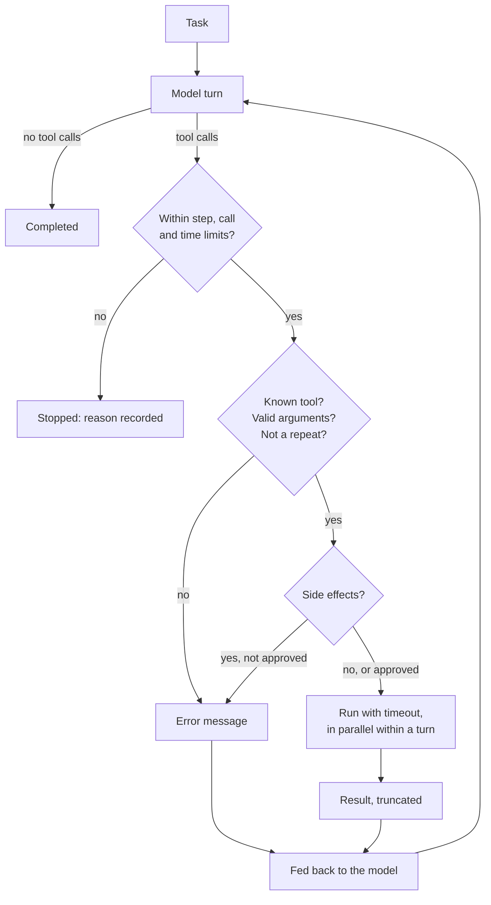

# agent-tool-runtime

A small, strict runtime for tool-using LLM agents. The model decides what to do; the runtime decides what it is allowed to do, records every step, and can replay a run exactly.

No runtime dependencies. Python 3.10+. Works with any model through a one-method interface.

## Why a runtime at all

An agent loop is ten lines: call the model, run the tool it asked for, repeat. The other 400 lines here are the things that go wrong in that loop.

| What goes wrong | What the runtime does | Test |
|---|---|---|
| The model invents an argument or a tool | Arguments are validated against a schema derived from the function signature. The error names the allowed arguments and goes back to the model | 8 invalid shapes rejected |
| A tool raises | The exception becomes an error message for the model. The run continues | `test_errors_reach_the_model...` |
| A tool hangs | Per-tool timeout | same test |
| The model tries something destructive | Tools marked `side_effects=True` run only if an approval callback says yes. With no callback they never run | `test_side_effect_tools_need_approval` |
| The model loops forever | Hard limits on steps, tool calls and wall-clock time | two limit tests |
| The model repeats the same call | The third identical call is refused with a nudge to try something else | `test_repeated_identical_calls...` |
| A tool returns 2 MB of text | Output is truncated before it reaches the model, with a note saying how much was cut | `test_long_tool_output_is_truncated...` |
| "Why did it do that in production?" | Every model turn and tool result is traced. `replay(trace)` re-runs the agent from the trace with no model calls and no side effects | `test_trace_round_trip_and_replay...` |

## The loop



## Define tools as plain functions

```python
from typing import Literal
from agentrt import Agent, Policy, ToolError, ToolRegistry

tools = ToolRegistry()

@tools.tool
def list_orders(customer_id: str, status: Literal["delivered", "in_transit", "any"] = "any") -> list:
    """List a customer's order ids, optionally filtered by status."""
    ...

@tools.tool(side_effects=True, timeout_s=5)
def issue_refund(order_id: str, amount: int) -> dict:
    """Refund an amount in rupees. This moves money and needs human approval."""
    ...

agent = Agent(model, tools, Policy(max_steps=8, approve=ask_a_human))
result = agent.run("Customer c-17 wants a refund for their delivered order.")
result.output, result.stop_reason, result.trace.summary()
```

Type hints become the JSON Schema sent to the model; the docstring becomes the description. A tool without a docstring or with an untyped parameter is rejected at registration, because the model would be guessing.

`model` is anything with `next_turn(messages, tools) -> ModelTurn`. Wrapping a provider SDK is a short adapter; none ships here.

## Demo

`python -m agentrt` runs a scripted "model" through a support task. It is scripted to make two mistakes so the guard rails show. No real model is called.

```
step 1  model: Let me find the customer's orders.
         calls: list_orders({'customer': 'c-17'})
         ERROR[invalid_arguments] list_orders -> Invalid arguments for list_orders: unknown argument(s): ['customer']. Allowed: ['customer_id', 'status']
step 2  model: I used the wrong argument name.
         calls: list_orders({'customer_id': 'c-17', 'status': 'delivered'})
         ok    list_orders -> ["A-1001"]
step 3  model: Checking the delivered order and one more.
         calls: get_order({'order_id': 'A-1001'}), get_order({'order_id': 'A-9999'})
         ok    get_order -> {"status": "delivered", "total": 2499, "customer": "c-17"}
         ERROR[tool_error] get_order -> no order with id 'A-9999'
step 4  model: The order qualifies; issuing the refund.
         calls: issue_refund({'order_id': 'A-1001', 'amount': 2499})
         ERROR[denied] issue_refund -> issue_refund changes things and was not approved. ...
step 5  model: Order A-1001 (delivered, 2,499 rupees) qualifies for a refund, but I am not permitted to issue it. ...

stop reason: completed after 5 steps
summary: {'model_turns': 5, 'tool_calls': 5, 'tool_errors': 3, 'denied': 1, 'stop_reason': 'completed'}
refunds actually issued: []
replay from trace reproduces the run: True
```

## Run it

```bash
pip install -e ".[dev]"
pytest -q          # 20 tests
python -m agentrt
```

## Limits

- **A timed-out tool is abandoned, not killed.** Python cannot stop a running thread, so the runtime stops waiting and reports a timeout while the function may still finish in the background. Tools with side effects should enforce their own deadlines.
- **No real model has been run against this.** Behaviour with a live model depends on the model; the tests cover the runtime's rules, not any model's judgement.
- **No sandbox.** Approval gates decide whether a tool runs, not what it can touch once it does.
- **No context management.** Long runs will outgrow a model's context window; summarising or trimming history is not implemented.
